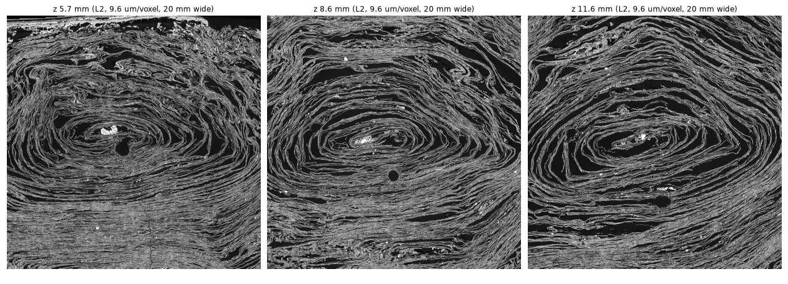
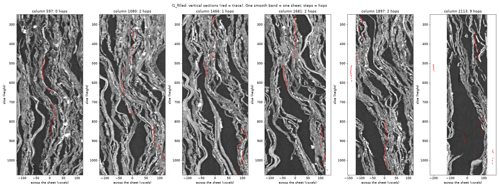
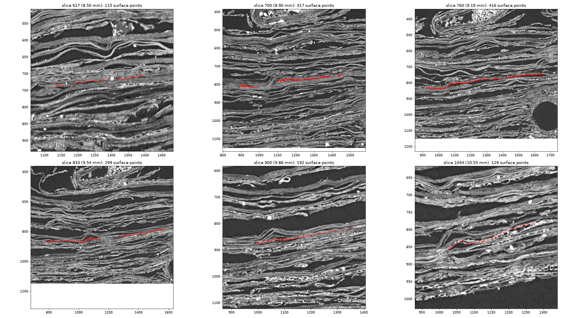
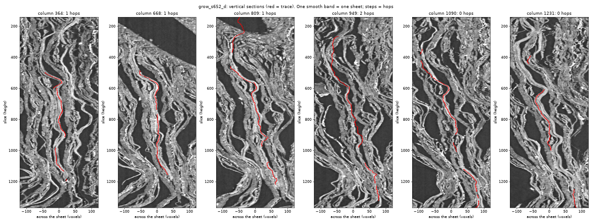
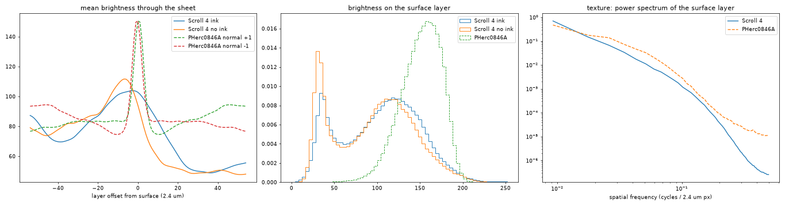
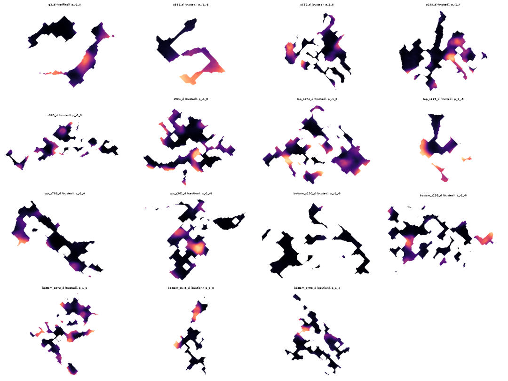
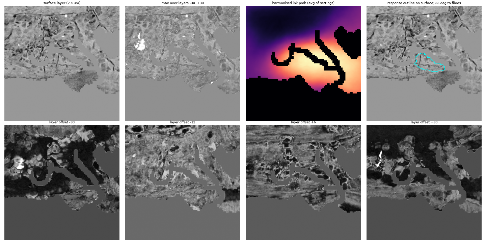

# Independent surface tracing and cross-scroll ink detection on PHerc0846A

*Progress Prize submission, October 2026. Code: this repository (MIT).*

## Summary

We built an end-to-end pipeline, from raw CT to ink predictions, without using the community
segmentation or ink-detection models, and ran it on an eligible scroll (PHerc0846A, 2.403 µm / 77 keV
scan). Everything ran on one laptop GPU (RTX PRO 5000, 24 GB).

What we think is useful to others:

1. **A renderer validated against the official surface volumes** (0.993 correlation), so surfaces
   traced by anyone can be turned into model input of exactly the published format.
2. **A 3D surface grower plus a vertical "section check"** that measures whether a surface stays on
   one sheet across heights. Per-slice overlays look clean even when a surface has jumped between
   sheets; the section check catches it.
3. **A densify pass** that fills holes in grown surfaces point by point against the data, raising
   usable surface interior from almost nothing to about 113 mm² over 15 sheets without adding jumps.
4. **A cross-scroll ink study** on held-out labelled scrolls: how much Scroll 4 models degrade on a
   new scroll, why brightness harmonisation looks helpful but is not, and how much training on several
   scrolls recovers.
5. **A calibrated negative result** for the surveyed region of PHerc0846A, including the false-alarm
   rate on known ink-free papyrus, which is what makes "quiet" interpretable.

We found no letters. We report the negative result because the calibration and pitfalls behind it are
likely to save others time.

## 1. Rendering surfaces (validated)

`src/surface/render.py` interpolates a tifxyz mesh to surface pixels, computes normals from the grid and
samples the CT at ±54 layers along the normal. Checked on Scroll 4 segment w031, against the official
surface volume over a 1024×1024 px area with dense ink labels (`src/surface/check_render.py`):

| Check | Result |
|---|---|
| Pixel correlation, 36 layers used by the models | 0.993 |
| Mean absolute difference | 3.6 grey levels |
| Layer alignment | exact (no offset) |
| Ink model, official render vs ours (F0.5) | 0.851 vs 0.856 |

One detail matters: the published surface volumes use the opposite normal direction to the
cross-product of the grid tangents (u × v). With the wrong sign, layers away from the surface do not
match at all (correlation −0.27).

## 2. Surfaces on PHerc0846A

**Scouting.** Of the two eligible scrolls with a 2.4 µm scan, PHerc1203 is crushed throughout at the
scales we inspected. PHerc0846A shows a clean, regular spiral in its inner wraps in the lower third,
about 4–13 mm up the scroll (`src/surface/scout.py`, `scout_zoom.py`).



**What did not work.** Slice-by-slice 2D tracing follows a sheet well within one slice (up to 15–20 mm
along a wrap), but carrying it through heights failed in two ways:

- at 9.6 µm the sheets are 2–4 voxels thick with neighbours 3–5 voxels away, so the trace slides onto
  touching sheets;
- "bridging" small breaks in a sheet makes long traces possible, but is also the main source of jumps
  to a neighbouring sheet.

Every slice in these traces looked correct. The vertical section check (below) showed hops in 49–85% of
columns.



**3D growing** (`src/surface/grow3d.py`). The surface is a grid of points at 19 µm spacing grown from a
seed at 4.8 µm resolution, best-supported cells first. Each new point is:

1. predicted by a local affine fit through its accepted neighbours;
2. snapped at most ±2 voxels across the sheet onto the brightness ridge;
3. accepted only if it lands on papyrus, keeps grid spacing (no stretch or fold), keeps its normal
   within 25° of its neighbours', lies at most 1.5–2 voxels across the sheet from each direct
   neighbour, and does not touch a non-adjacent part of the surface.

Weak spots are grown around rather than bridged.



**The section check** (`src/surface/section_check.py`) cuts the scan along the scroll axis, across the
sheet, for several positions on the surface, and counts hops: sideways moves larger than one sheet can
make between neighbouring slices (1.5 voxels per slice at 9.6 µm, scaled by resolution; across gaps,
0.3 voxels per slice plus a margin). Hop rate per slice step on the surfaces used below:

| Surface type | Hop rate per step | Columns with ≥ 1 hop |
|---|---|---|
| 2D tracer, filled | 0.79% | 68% |
| 3D grower, first version | 2.14% | 87% |
| 3D grower with across-sheet constraint | 0.07–0.76% ("trusted" ≤ 0.8%) | 12–59% |

**Densify** (`src/surface/grid_densify.py`). Grown surfaces are lace-like: most cells sit near a hole,
and models react to hole edges (section 4). Densify fills empty cells from the edges inward:

- each candidate cell is predicted by a plane fit through its 5×5 neighbourhood and snapped at most
  1.75 voxels;
- it is kept only if it lands on papyrus;
- holes over real gaps in the papyrus therefore stay open.

On sheet 652 it added 7,366 checked points and left the hop rate unchanged (0.13% → 0.14% of steps).



**Survey.** Twelve sheets in two further regions (above and below the first block) plus the first
region's sheets, grown with `src/surface/survey.py`, graded by hop rate, densified, rendered from
full-resolution CT bands. Total usable interior (≥ 0.25 mm from any hole or edge, measured on the
rendered maps): **112.7 mm² on 15 sheets**.

## 3. Ink models and cross-scroll transfer

All models take 32 layers around the surface at half resolution (4.8 µm px, 384 px windows) and are
trained with ink labels inside the supervision mask only (`src/ink/train_l1.py`, `models.py`).

**On Scroll 4** (validated on a whole held-out segment, w031):

| Model | AUC | F0.5 |
|---|---|---|
| 2D U-Net, full resolution, 256 px windows | 0.73 | 0.56 |
| 2D U-Net, half resolution, 384 px windows | 0.83 | 0.64 |
| Small 3D front end + 2D U-Net (`quick3d`) | 0.90 | 0.79 |
| 3D ResNet-18 encoder, video-pretrained (`full3d`) | 0.92 | 0.79 |
| Average of `quick3d` and `full3d` | 0.93 | 0.81 |
| Published community predictions, scored at 1/8 resolution (reference only) | 0.90 | 0.78 |

Half resolution helped most (strokes are about 300 px wide at 2.4 µm, so a full-resolution window
mostly sees the inside of one stroke); 3D depth processing helped next. The community comparison is
indicative only: their published predictions are downsampled JPGs, and the labels may partly derive
from their model.

**On a scroll the model has never seen.** PHerc0841 has ink labels on the same scan series as
PHerc0846A (2.403 µm, 77 keV), so it is the closest available test (`src/ink/cross_scroll_test.py`;
AUC per labelled segment):

| Model | 20260220213127 | 20260220214732 | 20260221022814 |
|---|---|---|---|
| Scroll 4 pair, raw input | 0.658 | 0.803 | 0.770 |
| Scroll 4 pair, harmonised input | 0.546 | 0.689 | 0.699 |
| Scroll 4 model, robust per-patch normalisation | 0.707 | 0.794 | 0.734 |
| **Multi-scroll** (Scroll 4 + PHerc0139 + Scroll 1; PHerc0841 held out) | **0.873** | **0.836** | **0.799** |

Three lessons:

- **Transfer is weak.** About 0.90 on a held-out Scroll 4 segment becomes 0.66–0.80 on a new scroll.
- **Harmonisation hurts real ink.** Mapping each layer's brightness distribution onto Scroll 4's
  removed the model's "ink everywhere" response on PHerc0846A. A control (Scroll 4 disguised with
  PHerc0846A's brightness and noise, then harmonised back) looked reassuring (AUC 0.86 → 0.66 → 0.83).
  But on real ink from another scroll, harmonisation *lowers* AUC by 0.07–0.11 and collapses
  probabilities. The control only reproduced brightness and noise; the real differences between
  scrolls are structural. Measured differences (`src/surface/diagnose_domain.py`): PHerc0846A's
  surface layer is much brighter and narrower in range (p10–p90 of 118–179 vs 33–158) and has more
  fine-scale noise (6.6 vs 3.0 grey levels).
- **Training on several scrolls is what helped**, with balanced sampling so each scroll counts
  equally: +0.03 to +0.22 AUC on the held-out scroll.



**Calibration.** Before reading any result on unlabelled papyrus we measured the false-alarm rate on
known ink-free papyrus of PHerc0841 (share of pixels above 0.5):

| Model | On ink | On ink-free papyrus |
|---|---|---|
| Multi-scroll | 41.2% | **2.5%** |
| Multi-scroll + grey-hole augmentation | 61.7% | 10.9% |

## 4. Result on PHerc0846A

Responses on unlabelled surfaces were dominated by two artefacts, which we removed before drawing
conclusions:

- **Hole and edge effects.** Models react to the boundary between papyrus and the flat grey we fill
  holes with. Densified surfaces plus scoring only interior pixels (≥ 0.25 mm from any hole or edge)
  remove most of it (`src/surface/interior_rescore.py`). Training with grey-filled holes as
  augmentation did not help: it raised the false-alarm rate to 10.9%.
- **Domain shift.** See section 3.

With the multi-scroll model on the densified surfaces, the median share of interior above 0.5 is
0–3% on 11 of the 15 sheets, at or near the model's 2.5% false-alarm rate. Two sheets (bottom 372 and
255) are raised (10%, 7%) and the two models agree spatially there (correlation up to 0.66). The
agreement comes from a single 0.4 × 0.24 mm blob wrapped around a branching crack in the surface.
Models see a 1.8 mm window, so a crack can influence them beyond the 0.25 mm margin. Two very small
interiors (0.9 and 1.4 mm²) are also raised but too small to judge. No response anywhere has a stroke
or letter shape.





**Interpretation.** In the surveyed region, the inner wraps of the lower third of PHerc0846A, our best
model finds no ink beyond its false-alarm level. This is **not** evidence that the papyrus is blank:

- the model reaches only AUC 0.80–0.87 on a new scroll;
- PHerc0846A's ink may differ in X-ray contrast from the training scrolls;
- 113 mm² is about a quarter of the 4 cm² First Letters area.

## 5. Pitfalls worth knowing

- **Per-slice overlays are not enough** to verify a surface. Check continuity along the scroll axis.
- **Bridging gaps in a sheet is both what makes long traces possible and the main cause of sheet jumps.**
  A grower that goes around weak spots avoids most of it.
- **Grey-filled holes are seen as structure** by ink models. Score interiors only, or close the holes.
- **"Model goes quiet" is not "no ink"** unless you know the model's false-alarm rate *and* its hit
  rate on that kind of data. Harmonisation made our models quiet by suppressing everything.
- **A synthetic domain-shift control can mislead.** Test transfer on a real labelled scroll from the
  same scan series.

## 6. Limitations

- Ink labels exist for few scrolls; our multi-scroll model saw three. More scrolls (or self-training
  on unlabelled ones) is the obvious next step.
- Surfaces were grown in three regions of one scroll, about 113 mm² of usable interior in total.
- No model ensembling or test-time augmentation for the PHerc0846A runs.
- Results on Scroll 4 use one held-out segment (w031); rotating the held-out segment would tighten
  the numbers.

## 7. Reproducing

The trained models are released as `weights-v1` (CC BY-NC 4.0): `multiscroll`, `quick3d`, `full3d`.
To skip training, download them and go straight to the PHerc0846A steps:

```bash
uv sync
uv run python src/ink/download_weights.py

# Scroll 4 training data (half resolution, labelled areas) and a quick 3D model
uv run python src/fetch_ink_l1.py
uv run python src/ink/train_l1.py --model 3d --iters 10000

# Labelled blocks from other scrolls, then the multi-scroll model with PHerc0841 held out
uv run python src/ink/fetch_labelled.py PHerc0139 PHercParis4 PHerc0841 --max-blocks 80
uv run python src/ink/train_l1.py --model 3d --aug strong --photo --balance \
    --scrolls PHerc1667 PHerc0139 PHercParis4 PHerc0841 --val-scroll PHerc0841 --iters 10000

# PHerc0846A: scouting, tracing block, surfaces, CT band, ink, interior scoring
uv run python src/surface/scout.py fetch && uv run python src/surface/scout.py figures
uv run python src/surface/fetch_trace_region.py
uv run python src/surface/fetch_trace_l1.py --tag bottom --box 250 850 1350 1750 300 1700
uv run python src/surface/survey.py --region bottom --x 1472 --z 704 --targets 130 255 372 511 648 798 --phase grow
uv run python src/surface/grid_densify.py --name bottom_s372
uv run python src/surface/fetch_ct_band.py --region bottom --y 0 896 --name bottom_band
uv run python src/surface/rerun_ink.py --run multiscroll --tag msd --variant d
uv run python src/surface/interior_rescore.py --tag msd
```

Run folders are created under `runs/`; set their names in `src/ink/registry.py` so the analysis
scripts find them. Long training runs can be paused and resumed (`--pause-at HH:MM`,
`--pause-iter N`, a `PAUSE` file in the run folder, `--resume <run folder>`).

## Data and attribution

Data: Vesuvius Challenge open data, CC BY-NC 4.0; Scrolls 1–4 under the additional EduceLab-Scrolls
terms (Parsons et al. 2023, arXiv:2304.02084). Figures in this document show PHerc0846A data
(CC BY-NC 4.0).
